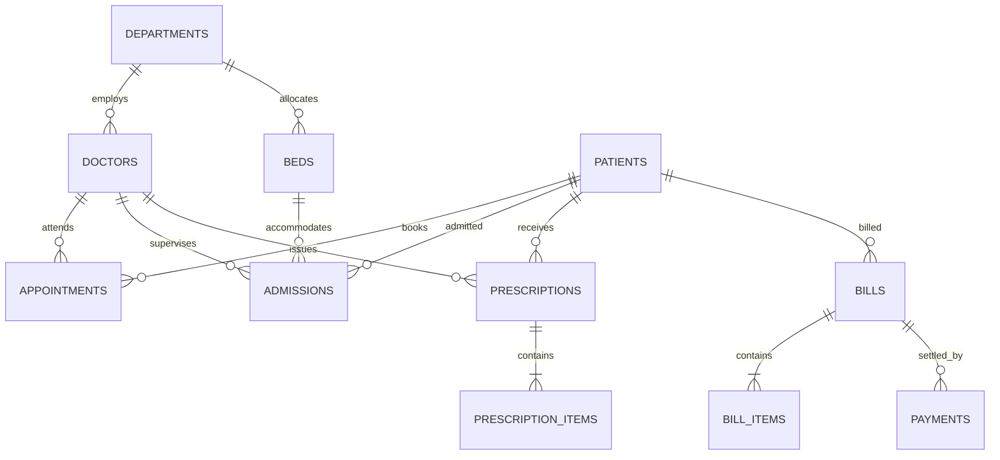

# MediTrack — Hospital Management and Patient Tracking System

> **A Complete, Production-Grade Hospital Operations & DBMS Laboratory Micro-Project**
> Developed with React 18, Vite, TypeScript, Tailwind CSS, GSAP, Express.js, and PostgreSQL.

[](https://nodejs.org/)
[](https://www.postgresql.org/)
[](https://www.typescriptlang.org/)
[](https://tailwindcss.com/)

---

## 1. Project Overview

**MediTrack** is an enterprise-grade hospital operations and patient tracking web application developed to demonstrate advanced relational database concepts covered in Computer Science Engineering Database Management Systems (DBMS) coursework.

Unlike static prototypes or mock dashboards, MediTrack features an end-to-end full-stack architecture with live PostgreSQL persistence, atomic ACID transaction handling, foreign-key referential integrity, GiST exclusion constraints for anti-overlap booking, partial unique indexes, stored functions, triggers, and automated audit logging.

---

## 2. Key Modules & Operational Workflows

1. **Overview Dashboard**: Live KPIs, today's consultation schedule, ward bed occupancy gauge, and 30-day department workload analytics.
2. **Patient Directory**: Searchable, filterable patient records with demographics, blood groups, and medical history (appointments, admissions, prescriptions, and billing ledger).
3. **Appointment Scheduling**: Outpatient scheduling with anti-double-booking safeguards preventing doctor and patient schedule conflicts.
4. **Doctor & Staff Management**: Physician directory with specialty filters, consultation fees, active admission guards, and daily availability slots.
5. **Inpatient Admissions & Bed Management**: Complete admission lifecycle with atomic bed locking, stay duration tracking, and discharge reconciliations.
6. **Clinical Departments**: Multi-specialty unit management with assigned head physicians and ward capacities.
7. **Prescription Charting**: Multi-item medication prescribing with dosage frequency, administration routes, and immutable record finalisation.
8. **Invoicing & Ledger Settlement**: Itemized hospital service billing, multi-channel payment recording (UPI, Card, Cash, NEFT), and overpayment safeguards.
9. **Hospital Analytics & Reports**: Server-side SQL reporting on doctor workload, inpatient length of stay, monthly revenue trajectories, and payment methods.
10. **System Administration & Audit Ledger**: Live database health ping, architectural parameters, and polymorphic audit trail inspector.

---

## 3. Technology Stack

- **Frontend**: React 18, Vite, TypeScript, Tailwind CSS, GSAP with ScrollTrigger, Recharts, Lucide React, React Hook Form, Zod.
- **Backend**: Node.js, Express.js, TypeScript, `pg` (node-postgres connection pool), Zod request validation, Centralized Error Handling.
- **Database**: PostgreSQL 14+ / 18, `btree_gist` extension, Versioned SQL migrations, Comprehensive seed dataset.
- **DBMS Inspection Tool**: Compatible with pgAdmin 4 for examiner demonstrations.

---

## 4. Database Architecture & ER Model



For complete technical specifications, see:
- [ER Diagram & Cardinality Specifications](docs/ER_DIAGRAM.md)
- [PostgreSQL Schema & Constraints Reference](docs/DATABASE_SCHEMA.md)
- [Hospital Business Rules & Integrity Rules](docs/BUSINESS_RULES.md)

---

## 5. Quick Start & Setup

### Prerequisites
- Node.js 18+
- PostgreSQL 14+ installed and running

### Step 1: Environment Setup
```bash
cp .env.example .env
# Edit .env with your local PostgreSQL password
```

### Step 2: Database Creation, Migration & Seeding
```bash
# Create database
psql -U postgres -c "CREATE DATABASE meditrack;"

# Execute migrations in order
psql -U postgres -d meditrack -f database/migrations/001_core_tables.sql
psql -U postgres -d meditrack -f database/migrations/002_transactional_tables.sql
psql -U postgres -d meditrack -f database/migrations/003_indexes_views_functions.sql

# Seed multi-month realistic medical dataset
psql -U postgres -d meditrack -f database/seeds/seed_data.sql
```

### Step 3: Install Dependencies & Run
```bash
# Install workspace dependencies
npm run install:all

# Launch both servers concurrently
npm run dev
```

- **Frontend App**: `http://localhost:5173`
- **Backend API**: `http://localhost:5000`
- **API Health Check**: `http://localhost:5000/api/health`

---

## 6. Viva Demonstration & pgAdmin 4 Guide

A dedicated directory of 13 standalone SQL scripts is provided in `database/sql-examples/` for live execution during course examinations:

- `01_database_setup.sql`: Database initialization & extension setup
- `02_create_tables.sql`: Relational DDL definitions
- `03_constraints_and_indexes.sql`: Constraints, partial indexes & GiST anti-overlap rules
- `04_seed_data.sql`: Seed data verification
- `05_insert_update_delete.sql`: DML operations with RETURNING clause
- `06_basic_select_queries.sql`: Filtering, DISTINCT, and pagination
- `07_join_queries.sql`: 2-way, 3-way, 5-way joins and outer joins
- `08_nested_subqueries.sql`: Scalar subqueries, NOT EXISTS, and derived tables
- `09_aggregate_group_by_having.sql`: COUNT, SUM, AVG, GROUP BY & HAVING
- `10_views_functions_triggers.sql`: Views, stored functions & audit triggers
- `11_transactions_and_concurrency.sql`: BEGIN, COMMIT, ROLLBACK, SAVEPOINT & FOR UPDATE locking
- `12_reports.sql`: Complex analytical reporting queries
- `13_ddl_alter_drop_truncate.sql`: Safe DDL demonstrations on disposable tables

See [Examiner Demonstration Guide](docs/DEMO_GUIDE.md) for full viva talking points and model answers.

---

## 7. Educational Scope Disclaimer

*MediTrack is an educational hospital operations and database management systems application developed with synthetic patient records for Computer Science Engineering course requirements. It is not intended for real-world clinical decision support or live medical diagnostic deployment.*
