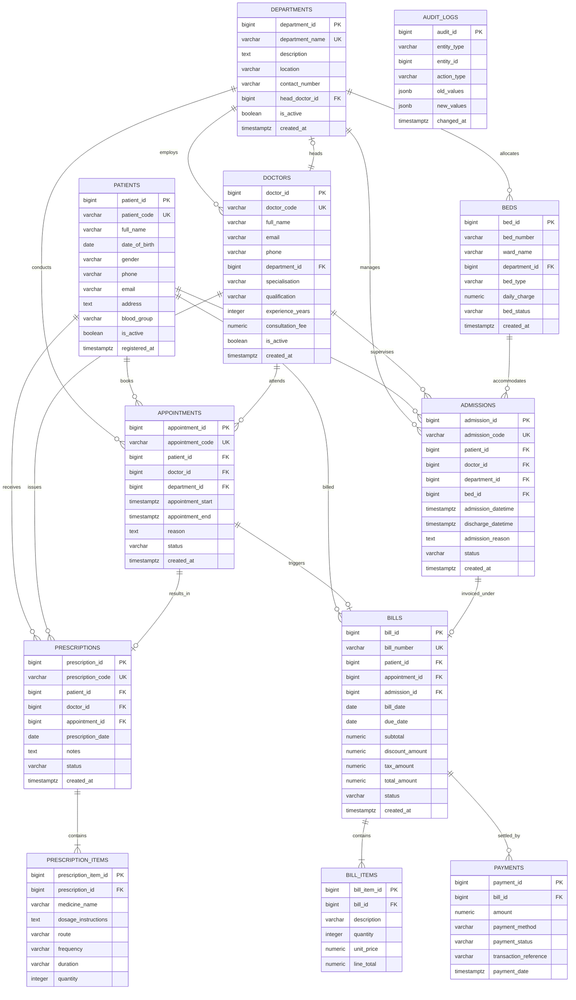

# MediTrack — Entity Relationship (ER) Diagram & Relational Model

This document outlines the conceptual and logical database design for **MediTrack**, a Hospital Management and Patient Tracking System built for PostgreSQL.

---

## 1. Mermaid Entity-Relationship Diagram

---

## 2. Cardinality & Participation Specifications

| Relationship | Cardinality | Participation | Business Explanation |
| :--- | :---: | :---: | :--- |
| **Department to Doctor** | 1 : N | Total on Doctor, Partial on Department | Every doctor must belong to 1 department. A department may employ 0, 1, or many doctors. |
| **Department to Bed** | 1 : N | Total on Bed, Partial on Department | Every hospital bed is located within a department ward. |
| **Patient to Appointment** | 1 : N | Partial on Patient | A patient may register without scheduling an immediate appointment. |
| **Doctor to Appointment** | 1 : N | Partial on Doctor | A doctor can have 0 to many consultations scheduled over time. |
| **Bed to Active Admission**| 1 : 1 (Active) | Partial on Bed | A bed can hold at most **one** active inpatient. Enforced via PostgreSQL Partial Unique Index. |
| **Prescription to Items** | 1 : N | Total on Item | A prescription consists of 1 or more line items (First Normal Form). |
| **Bill to Bill Items** | 1 : N | Total on Item | Every bill invoice is itemized into discrete service charges. |
| **Bill to Payments** | 1 : N | Partial on Bill | A bill starts with 0 payments and can receive multiple installment payments until settled. |

---

## 3. Relational Schema in Mathematical Notation

- **DEPARTMENTS** (<ins>department_id</ins>, department_name, description, location, contact_number, head_doctor_id*, is_active, created_at)
- **PATIENTS** (<ins>patient_id</ins>, patient_code, full_name, date_of_birth, gender, phone, email, address, blood_group, is_active, registered_at)
- **DOCTORS** (<ins>doctor_id</ins>, doctor_code, full_name, email, phone, department_id*, specialisation, qualification, experience_years, consultation_fee, is_active, created_at)
- **BEDS** (<ins>bed_id</ins>, bed_number, ward_name, department_id*, bed_type, daily_charge, bed_status, created_at)
- **APPOINTMENTS** (<ins>appointment_id</ins>, appointment_code, patient_id*, doctor_id*, department_id*, appointment_start, appointment_end, reason, notes, status, created_at)
- **ADMISSIONS** (<ins>admission_id</ins>, admission_code, patient_id*, doctor_id*, department_id*, bed_id*, admission_datetime, discharge_datetime, admission_reason, status, created_at)
- **PRESCRIPTIONS** (<ins>prescription_id</ins>, prescription_code, patient_id*, doctor_id*, appointment_id*, prescription_date, notes, status, created_at)
- **PRESCRIPTION_ITEMS** (<ins>prescription_item_id</ins>, prescription_id*, medicine_name, dosage_instructions, route, frequency, duration, quantity)
- **BILLS** (<ins>bill_id</ins>, bill_number, patient_id*, appointment_id*, admission_id*, bill_date, due_date, subtotal, discount_amount, tax_amount, total_amount, status, created_at)
- **BILL_ITEMS** (<ins>bill_item_id</ins>, bill_id*, description, quantity, unit_price, line_total)
- **PAYMENTS** (<ins>payment_id</ins>, bill_id*, amount, payment_method, payment_status, transaction_reference, payment_date)
- **AUDIT_LOGS** (<ins>audit_id</ins>, entity_type, entity_id, action_type, old_values, new_values, changed_at)

*(Note: Underlined attributes denote Primary Keys; asterisks `*` denote Foreign Keys).*
